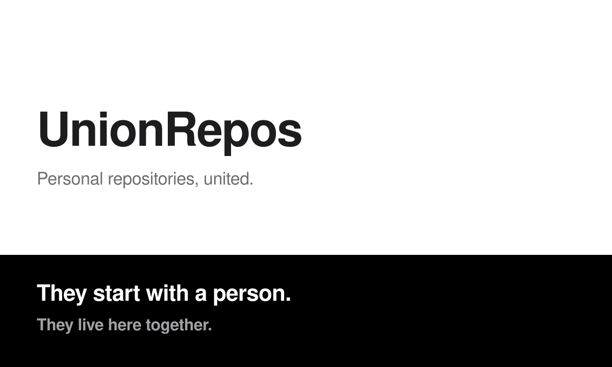

<picture>
  <source media="(prefers-color-scheme: dark)" srcset="./banner-dark.svg">
  <source media="(prefers-color-scheme: light)" srcset="./banner-light.svg">
  
</picture>

A personal repository can begin under one account. UnionRepos is where those repositories are gathered into one organization.

The commits stay. The issues stay. The name stays.

Public repositories are listed on the [website](https://unionrepos.github.io/).
